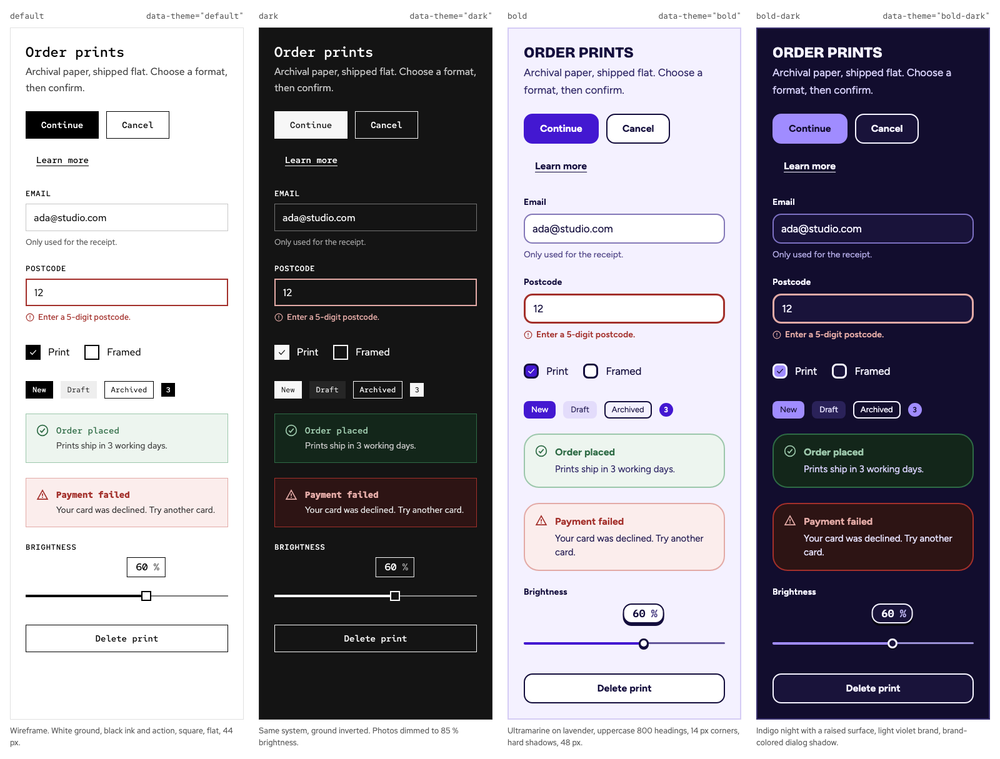
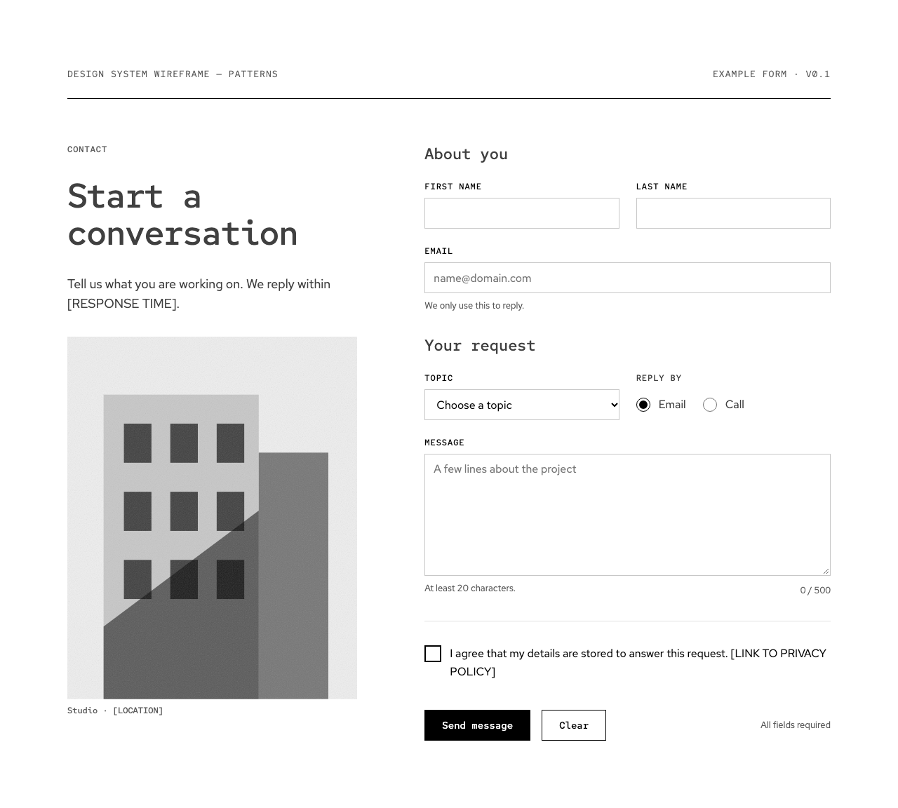
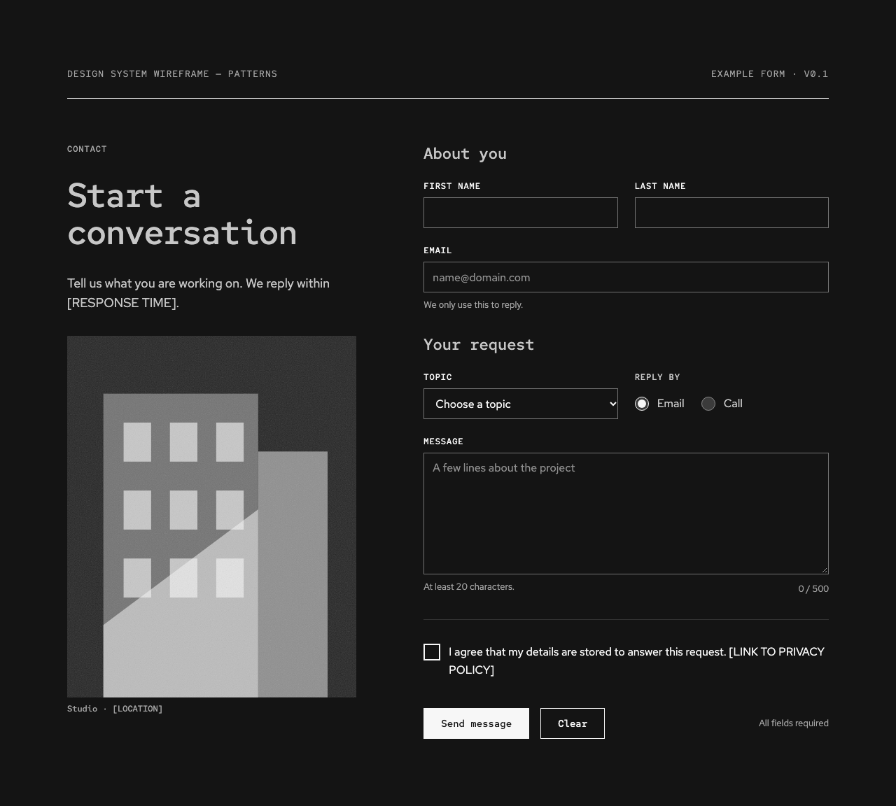
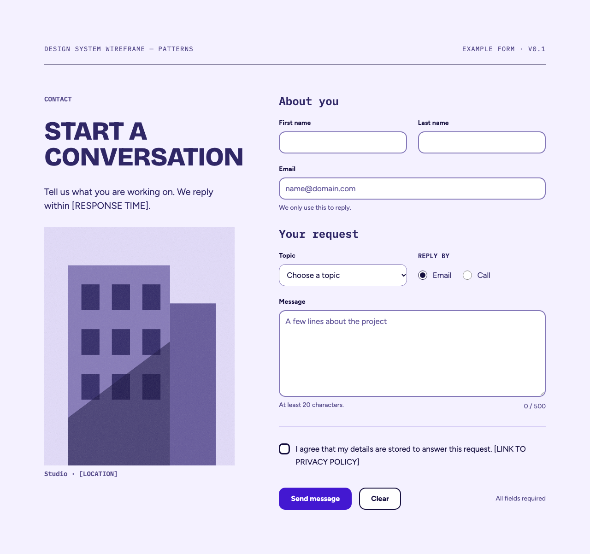
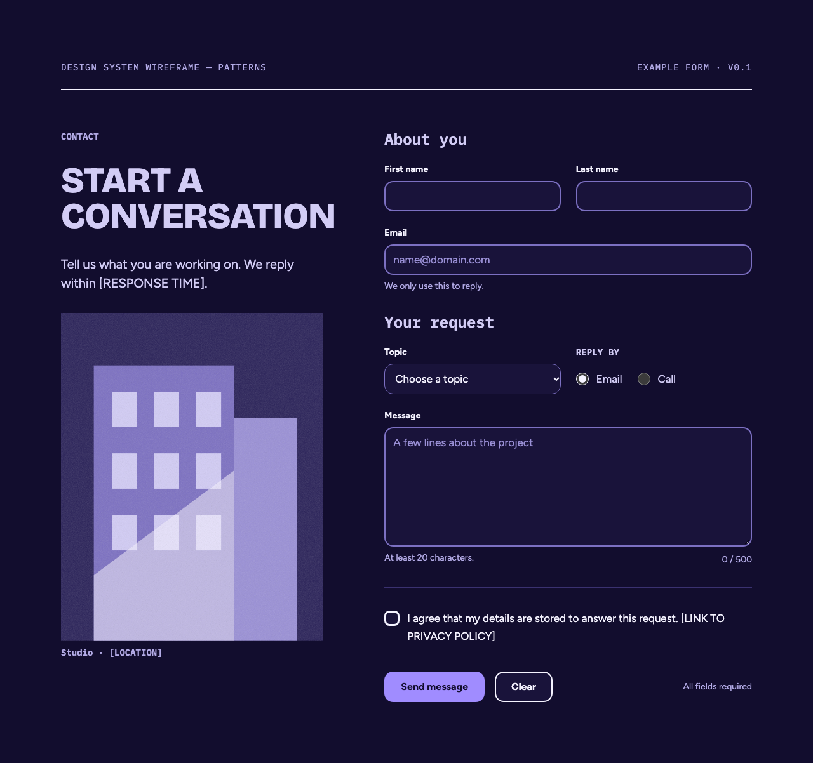
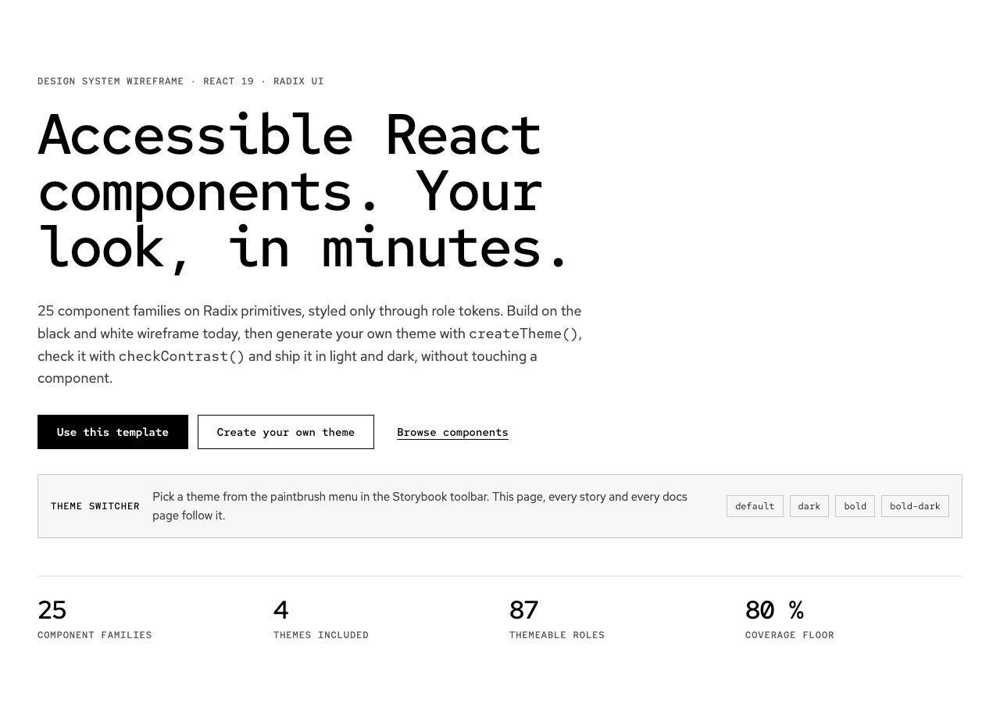

# Design System Wireframe

A themeable, accessible React design system on Radix primitives: pick a brand color, generate a theme, and every component follows, with Storybook and tests included.

[](https://github.com/mikespineu/design-system-wireframe/actions/workflows/ci.yml)
[](LICENSE)
[](https://ds.mikespin.dev/)
[](https://github.com/mikespineu/design-system-wireframe/generate)



## Why use it

- **Built on Radix primitives.** Focus, keyboard navigation and ARIA come from [Radix UI](https://www.radix-ui.com/primitives); we style them and add nothing hand-rolled. The rule is in [`CLAUDE.md`](CLAUDE.md#radix-primitives-required), and each component spec names its primitive, for example [`Dialog`](docs/specs/Dialog.md).
- **A role-token contract you can restyle.** Components read only semantic `--ds-*` roles, and all library CSS lives in `@layer ds`, so your unlayered rules always win. The roles are defined in [`docs/specs/Theming.md`](docs/specs/Theming.md) and implemented in [`src/styles/tokens.css`](src/styles/tokens.css).
- **A theme generator with a contrast check.** `createTheme()` turns a brand color, neutrals, fonts, radius and shadow into a `[data-theme]` block, and `checkContrast()` tells you which role pairs fail. See [Create your own theme](docs/theming-guide.md).
- **Restyle everything with no component changes.** The `bold` and `bold-dark` themes change color, type, radius and shadow for every component without touching one; compare the [per-theme screenshots](#customize-in-minutes) and the generated [`bold.css`](src/themes/bold.css).
- **Tested by default.** Every component has a story per state, keyboard stories, a `jest-axe` check and tests ([conventions](CLAUDE.md#conventions)), and [CI](.github/workflows/ci.yml) runs lint, typecheck and `npm test -- --coverage` against the [80 % coverage threshold](jest.config.cjs).

## Start from it

Click **Use this template** on GitHub, then follow the [starter guide](docs/starter-guide.md): rename the package, make your theme the default, decide what to keep, set up the workflows, and end with a green build. To install the components in an existing app, see the [consumer guide](docs/consumer-guide.md).

## Customize in minutes

One brand color is enough to start. This is [`docs/theming-guide/samples/minimal.ts`](docs/theming-guide/samples/minimal.ts), which the tests run:

```ts
import { createTheme } from 'design-system-test'

// The smallest useful input: one brand color, nothing else chosen.
// Unset radius is 0, unset shadow is none, unset neutral gives pure grays.
export const acme = createTheme({
  name: 'acme',
  brand: '#0b6e4f',
  fonts: { heading: "'Inter', system-ui, sans-serif", body: "'Inter', system-ui, sans-serif" },
  radius: {},
  shadow: {},
  mode: 'both',
})

// acme.css holds two blocks: [data-theme="acme"] (light, every role) and
// [data-theme="acme-dark"] (dark, color roles only).
export const selectors: string[] = acme.blocks.map((block) => block.selector)
```

It writes two blocks, `[data-theme="acme"]` and `[data-theme="acme-dark"]`; set `data-theme` on `<html>` to switch. Check it with `checkContrast()` and add overrides in the [theming guide](docs/theming-guide.md). The same contact form, with no code change, in each shipped theme:

| `default` | `dark` |
| --- | --- |
|  |  |

| `bold` | `bold-dark` |
| --- | --- |
|  |  |

## Components

Every component has a docs page in the [live Storybook](https://ds.mikespin.dev/):

- **Actions:** [Button](https://ds.mikespin.dev/?path=/docs/components-button--docs), [ButtonGroup](https://ds.mikespin.dev/?path=/docs/components-buttongroup--docs), [IconButton](https://ds.mikespin.dev/?path=/docs/components-iconbutton--docs)
- **Form controls:** [Input](https://ds.mikespin.dev/?path=/docs/components-input--docs), [Textarea](https://ds.mikespin.dev/?path=/docs/components-textarea--docs), [Select](https://ds.mikespin.dev/?path=/docs/components-select--docs), [Checkbox](https://ds.mikespin.dev/?path=/docs/components-checkbox--docs), [RadioGroup](https://ds.mikespin.dev/?path=/docs/components-radiogroup--docs), [Switch](https://ds.mikespin.dev/?path=/docs/components-switch--docs), [Slider](https://ds.mikespin.dev/?path=/docs/components-slider--docs), [SegmentedControl](https://ds.mikespin.dev/?path=/docs/components-segmentedcontrol--docs), [TileGroup](https://ds.mikespin.dev/?path=/docs/components-tilegroup--docs)
- **Overlays and feedback:** [Dialog](https://ds.mikespin.dev/?path=/docs/components-dialog--docs), [Drawer](https://ds.mikespin.dev/?path=/docs/components-drawer--docs), [Popover](https://ds.mikespin.dev/?path=/docs/components-popover--docs), [Tooltip](https://ds.mikespin.dev/?path=/docs/components-tooltip--docs), [InfoTip](https://ds.mikespin.dev/?path=/docs/components-infotip--docs), [Toast](https://ds.mikespin.dev/?path=/docs/components-toast--docs), [Alert](https://ds.mikespin.dev/?path=/docs/components-alert--docs)
- **Navigation and content:** [Tabs](https://ds.mikespin.dev/?path=/docs/components-tabs--docs), [Breadcrumb](https://ds.mikespin.dev/?path=/docs/components-breadcrumb--docs), [Tag](https://ds.mikespin.dev/?path=/docs/components-tag--docs), [Icon](https://ds.mikespin.dev/?path=/docs/foundations-icon--docs)
- **Layout:** [Stack](https://ds.mikespin.dev/?path=/docs/layout-stack--docs), [Grid](https://ds.mikespin.dev/?path=/docs/layout-grid--docs)

## Stack

| Area | Choice |
| --- | --- |
| UI | React 19 + TypeScript |
| Primitives | [`radix-ui`](https://www.radix-ui.com/primitives) (focus, keyboard, ARIA); styled only with our tokens |
| Styling | Plain CSS per component, driven by `--ds-*` variables in [`src/styles/tokens.css`](src/styles/tokens.css); Tailwind 4 for Storybook |
| Build / docs | Vite, Storybook 10 |
| Tests | Jest 30 (jsdom, `@swc/jest`), Testing Library, `userEvent`, `jest-axe`; coverage threshold 80 % |
| Lint | ESLint + `tsc --noEmit`; Husky `pre-push` runs lint and tests |

Components live in `src/components/<Name>/` (`<Name>.tsx`, `.css`, `.stories.tsx`, `.test.tsx`, `index.ts`) and are exported from [`src/index.ts`](src/index.ts). Project rules for contributors and agents are in [`CLAUDE.md`](CLAUDE.md).

## Storybook

Storybook is the living catalogue: every component has a story per state plus keyboard stories.



Run it locally:

```bash
npm ci
npm run storybook        # http://localhost:6006
```

`:6006` is for the primary checkout only. Each git worktree (`.worktrees/<name>`) gets its own deterministic port so several can run side by side:

```bash
PORT=$((6100 + $(basename "$PWD" | cksum | cut -d' ' -f1) % 900))   # 6100-6999
npx storybook dev -p "$PORT" --no-open
```

If the port is taken, pick the next free one; never kill another process. A static build is `npm run build-storybook`.

Deployed Storybook: [ds.mikespin.dev](https://ds.mikespin.dev/).

## Commands

| Command | What it does |
| --- | --- |
| `npm run storybook` | Storybook dev server |
| `npm run build-storybook` | Static Storybook build |
| `npm test` / `npm run test:coverage` | Jest, with or without coverage |
| `npm run typecheck` | `tsc --noEmit` |
| `npm run lint` / `npm run lint:fix` | ESLint |
| `npm run factory:status` | Live factory status page |

All feature work happens in a git worktree under `.worktrees/`; see [`CLAUDE.md`](CLAUDE.md).

## How it's built

Components are drawn on a canvas first, then specified, then built; a Claude-driven software factory plans, designs and builds the roadmap in git worktrees, checked by hard gates.

- [Claude Design](docs/claude-design.md): canvases, specs, and the design to spec to build handoff.
- [Software factory](docs/factory/README.md): the roadmap, skills, agent pipeline, gates and job files.

## License

[MIT](LICENSE) © 2026 mikespin
