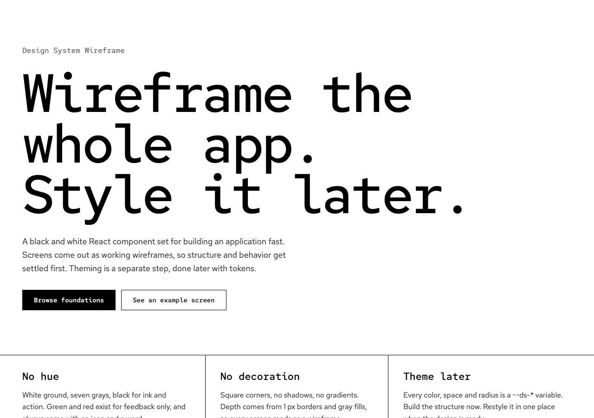
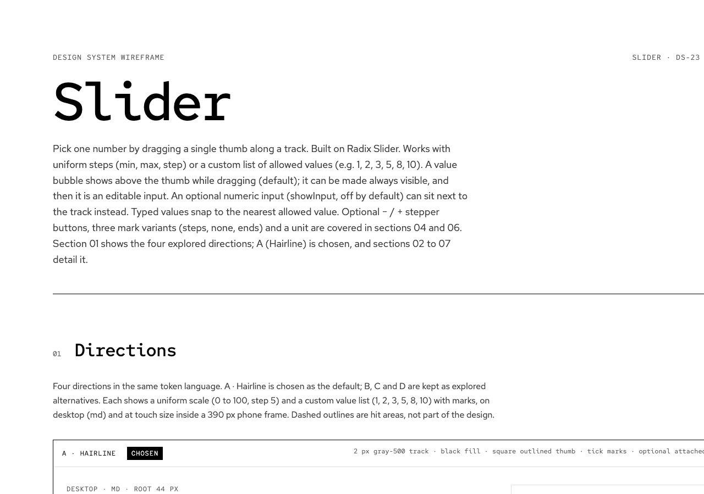
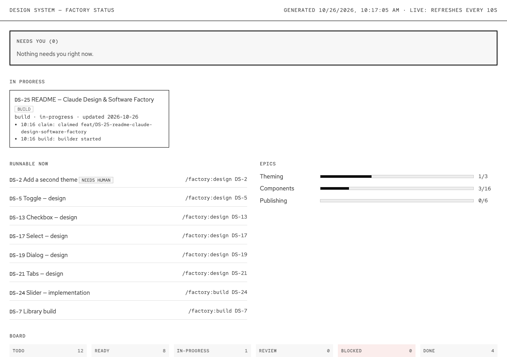

# Design System Wireframe

A minimal black / gray / white React design system. White ground, gray accents, black for ink and action, muted green and red for feedback only. Components are designed on a canvas first, built on [Radix UI](https://www.radix-ui.com/primitives) primitives, and shipped with Storybook stories and tests. A Claude-driven software factory plans, designs and builds the roadmap.

**Live preview:** [ds.mikespin.dev](https://ds.mikespin.dev/)

- [Stack](#stack)
- [Storybook](#storybook)
- [Claude Design](#claude-design)
- [Software Factory](#software-factory)
- [Commands](#commands)
- [License](#license)

## Stack

| Area | Choice |
| --- | --- |
| UI | React 19 + TypeScript |
| Primitives | [`radix-ui`](https://www.radix-ui.com/primitives) (focus, keyboard, ARIA); styled only with our tokens |
| Styling | Plain CSS per component, driven by `--ds-*` variables in [`src/styles/tokens.css`](src/styles/tokens.css); Tailwind 4 for Storybook |
| Build / docs | Vite, Storybook 10 |
| Tests | Jest 30 (jsdom, `@swc/jest`), Testing Library, `userEvent`, `jest-axe`; coverage threshold 80 % |
| Lint | ESLint + `tsc --noEmit`; Husky `pre-push` runs lint and tests |

Components live in `src/components/<Name>/` (`<Name>.tsx`, `.css`, `.stories.tsx`, `.test.tsx`, `index.ts`) and are exported from [`src/index.ts`](src/index.ts). Project rules for contributors and agents are in [`CLAUDE.md`](CLAUDE.md).

## Storybook

Storybook is the living catalogue: every component has a story per state plus keyboard stories.



Run it locally:

```bash
npm ci
npm run storybook        # http://localhost:6006
```

`:6006` is for the primary checkout only. Each git worktree (`.worktrees/<name>`) gets its own deterministic port so several can run side by side:

```bash
PORT=$((6100 + $(basename "$PWD" | cksum | cut -d' ' -f1) % 900))   # 6100-6999
npx storybook dev -p "$PORT" --no-open
```

If the port is taken, pick the next free one; never kill another process. A static build is `npm run build-storybook`.

Deployed Storybook: [ds.mikespin.dev](https://ds.mikespin.dev/).

## Claude Design

Components are designed before they are built. The design is a Claude Design canvas plus a written spec, and only an approved spec unlocks the build.



### Canvases

Canvases are `*.dc.html` files in [`docs/design-system-wireframe/`](docs/design-system-wireframe/). Open one in a browser, or in Claude Design for the published version.

| File | Contents |
| --- | --- |
| [`Main.dc.html`](docs/design-system-wireframe/Main.dc.html) | Foundations: color, typography, spacing, shape and line, photography |
| [`Components.dc.html`](docs/design-system-wireframe/Components.dc.html) | Buttons, inputs, selection controls, tags, navigation, cards, feedback, table |
| [`Form.dc.html`](docs/design-system-wireframe/Form.dc.html) | Example contact form with live validation |
| [`Textarea.dc.html`](docs/design-system-wireframe/Textarea.dc.html) | Textarea design (DS-3) |
| [`Slider.dc.html`](docs/design-system-wireframe/Slider.dc.html) | Slider design (DS-23) |

[`canvas.json`](docs/design-system-wireframe/canvas.json) holds the artboard layout; see the folder's [README](docs/design-system-wireframe/README.md).

### Specs

Each designed component has a spec in `docs/specs/<Name>.md`, for example [`Slider.md`](docs/specs/Slider.md) and [`Textarea.md`](docs/specs/Textarea.md). A spec names its task and canvas, and covers the proposed API, sizes and states, keyboard behavior, the Radix primitive to build on, the token mapping, accessibility, and any token requests. Its header records the approval (`approved`, `approved_by`, `approved_at`).

### Design to spec to build

1. **Design.** A `design` task (`/factory:design DS-n`) produces the canvas and a draft spec, and opens a draft PR with the canvas link.
2. **Approve.** You review the canvas. Ask for changes with `/factory:design DS-n <feedback>`, or approve with `/factory:approve DS-n`, which stamps the spec approved and lets the PR merge.
3. **Build.** The matching `build` task depends on the design task and becomes runnable once the approved spec is on `main`. The Builder implements the spec exactly (states, keyboard, tokens), with a story per state and tests. It cannot edit the spec or the canvas.

### Tokens connect design and code

Canvases and components share one vocabulary: semantic `--ds-*` CSS variables in [`src/styles/tokens.css`](src/styles/tokens.css) (for example `--ds-color-border`, `--ds-color-ink`, `--ds-control-height`). Specs map every state to a token, and components use only those variables, never hardcoded colors or spacing. Restyling the system means changing token values in one place. New raw values a design needs are listed as token requests in the spec and need human approval.

## Software Factory

The factory takes tasks from [`roadmap.md`](roadmap.md), designs or builds each one in its own git worktree with Claude subagents, checks the result with hard gates, opens a pull request, and merges it when checks pass and anything that needs you has your approval. Everything is a Claude Code skill: you type `/factory:...`. More detail: [`docs/factory/README.md`](docs/factory/README.md), [`docs/factory/design.md`](docs/factory/design.md), and the rules the skills follow in [`factory/plugin/RULES.md`](factory/plugin/RULES.md).



### Roadmap task format

Tasks live in `roadmap.md`, each with a unique, never reused ID:

```md
- [ ] **DS-4 Textarea — implementation.** Description.
  - type: build · has_ui: yes · depends_on: DS-3 · needs_human: no · status: todo
  - done_when:
    - Criterion
```

- `type`: `design`, `build`, `infra` or `docs`.
- `has_ui`: whether it touches components, styles or stories. A UI build needs an approved spec from its design task.
- `depends_on`: task IDs that must be done first.
- `needs_human`: `yes` tasks are skipped by `/factory:next`, and their PR needs your approval.
- `status`: `todo`, `ready`, `in-progress`, `review`, `done` or `blocked`.
- `done_when`: the checklist the work is verified against.

### Skills

All skills live in [`factory/plugin/skills/`](factory/plugin/skills/), one folder each with a `SKILL.md`.

| Skill | What it does |
| --- | --- |
| [`/factory:status`](factory/plugin/skills/status/SKILL.md) | Opens the status page: needs you, in progress, runnable, epics, board. `npm run factory:status` keeps it live (refreshes every 10 s) |
| [`/factory:next`](factory/plugin/skills/next/SKILL.md) | Shows the next runnable task and the command to start it |
| [`/factory:plan`](factory/plugin/skills/plan/SKILL.md) | The Planner researches the repo, backlog and job history and proposes next features as tasks; you pick, a roadmap PR lands them |
| [`/factory:add`](factory/plugin/skills/add/SKILL.md) | Turns a feature into correctly shaped roadmap tasks, previews them, and opens a roadmap PR after your ok |
| [`/factory:edit`](factory/plugin/skills/edit/SKILL.md) | Changes a todo or blocked task (fields, `done_when`, block / unblock) through a PR |
| [`/factory:design`](factory/plugin/skills/design/SKILL.md) | Design line: canvas and spec, published to claude.ai, draft PR waiting for you; also revises with feedback |
| [`/factory:build`](factory/plugin/skills/build/SKILL.md) | Build line: Builder, gates, QA, Reviewer, PR, merge on green checks |
| [`/factory:approve`](factory/plugin/skills/approve/SKILL.md) | Your approval of a design or of a PR that needs a human |
| [`/factory:merge`](factory/plugin/skills/merge/SKILL.md) | Re-checks a PR and squash-merges it if the merge rules allow |
| [`/factory:retry`](factory/plugin/skills/retry/SKILL.md) | Resumes a blocked task, optionally with a stronger model or accepting a UI change |

### Agent pipeline

```text
planner -> designer -> builder -> QA -> reviewer
```

Definitions are in [`factory/plugin/agents/`](factory/plugin/agents/): [`planner`](factory/plugin/agents/planner.md) (read-only research that proposes tasks), [`designer`](factory/plugin/agents/designer.md) (canvas and spec), [`builder`](factory/plugin/agents/builder.md) (test-first implementation), [`qa`](factory/plugin/agents/qa.md) and [`reviewer`](factory/plugin/agents/reviewer.md) (independent checks). The orchestrating session runs every check as a real command; pass or fail is decided by exit codes and the rules, never by an agent's opinion, and no agent approves its own output.

### Hard gates

Before QA and review, the task's worktree must pass, in order:

1. `npm run lint`
2. `npm run typecheck`
3. `npm test` (coverage threshold 80 %)
4. `npm run build-storybook`

A `has_ui: no` task is also stopped if it touches UI files. A failure goes back to the Builder; after the loop limit the task is blocked with the reason posted on its PR.

### Job files

Every task the factory touches gets a job file, `factory/jobs/DS-<n>.md`, created from [`TEMPLATE.md`](factory/jobs/TEMPLATE.md). It records status, stage, links (branch, PR, canvas, Storybook), fix-loop counts, a timeline and notes. It lands on `main` with the task's PR, so [`factory/jobs/`](factory/jobs/) is the factory's history, and the status page reads it. See the [jobs README](factory/jobs/README.md).

### Human approval points

The factory never approves on your behalf. You are needed to:

- approve a design (`/factory:approve DS-n`) before its spec is merged and the build can start;
- approve a PR for a `needs_human` task, or one that accepts a UI change on a `has_ui: no` task (`/factory:approve DS-n`, `/factory:retry DS-n --allow-ui`);
- choose which proposed tasks land from `/factory:plan`, and confirm tasks previewed by `/factory:add` and `/factory:edit`;
- unblock tasks stopped at the loop limit (`/factory:retry DS-n`).

PRs merge only when all GitHub checks are green, the PR is mergeable, and the approval label is present where required.

## Commands

| Command | What it does |
| --- | --- |
| `npm run storybook` | Storybook dev server |
| `npm run build-storybook` | Static Storybook build |
| `npm test` / `npm run test:coverage` | Jest, with or without coverage |
| `npm run typecheck` | `tsc --noEmit` |
| `npm run lint` / `npm run lint:fix` | ESLint |
| `npm run factory:status` | Live factory status page |

All feature work happens in a git worktree under `.worktrees/`; see [`CLAUDE.md`](CLAUDE.md).

## License

[MIT](LICENSE) © 2026 mikespin
