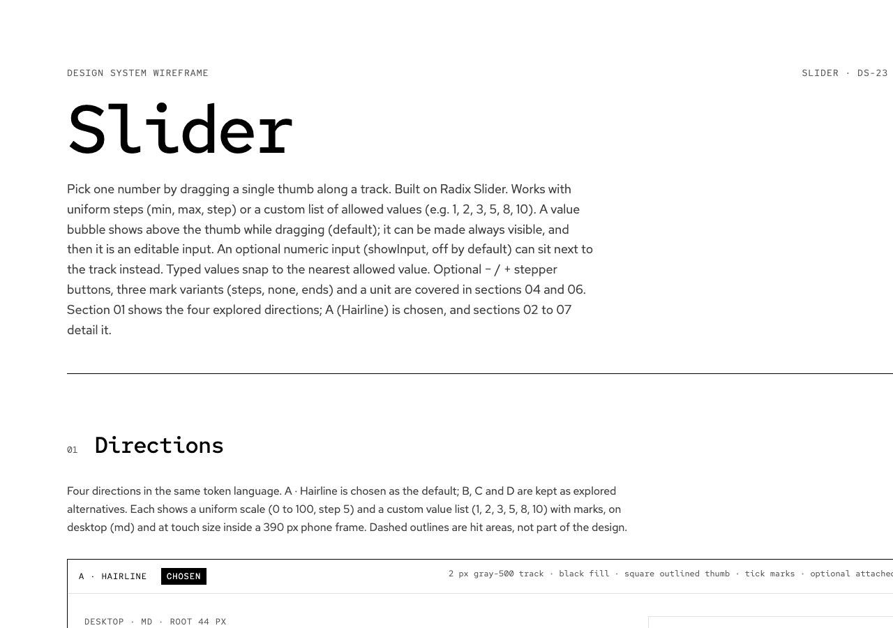

# Claude Design

Components are designed before they are built. The design is a Claude Design canvas plus a written spec, and only an approved spec unlocks the build. The [software factory](factory/README.md) runs this flow; back to the [README](../README.md).

## Canvases

Canvases are `*.dc.html` files in [`docs/design-system-wireframe/`](design-system-wireframe/). Open one in a browser, or in Claude Design for the published version.

| File | Contents |
| --- | --- |
| [`Main.dc.html`](design-system-wireframe/Main.dc.html) | Foundations: color, typography, spacing, shape and line, photography |
| [`AllComponents.dc.html`](design-system-wireframe/AllComponents.dc.html) | Every component exported from `src/index.ts` in its key states, drawn with the current `--ds-*` role tokens |
| [`Form.dc.html`](design-system-wireframe/Form.dc.html) | Example contact form with live validation (interactive) |
| [`Textarea.dc.html`](design-system-wireframe/Textarea.dc.html) | Textarea design (DS-3) |
| [`Slider.dc.html`](design-system-wireframe/Slider.dc.html) | Slider design (DS-23) |
| [`Dialog.dc.html`](design-system-wireframe/Dialog.dc.html) | Dialog design (DS-19) |
| [`Checkbox.dc.html`](design-system-wireframe/Checkbox.dc.html) | Checkbox and CheckboxGroup design (DS-13) |
| [`Toggle.dc.html`](design-system-wireframe/Toggle.dc.html) | Switch, SegmentedControl and TileGroup design (DS-5) |
| [`Theming.dc.html`](design-system-wireframe/Theming.dc.html) | Theme contract and knobs: roles, color, fonts, type scale, radius, shadow, dark (DS-26) |
| [`Themes.dc.html`](design-system-wireframe/Themes.dc.html) | Example themes default, dark, bold and bold-dark side by side, with roles, contrast and `createTheme()` inputs (DS-2) |
| [`RadioGroup.dc.html`](design-system-wireframe/RadioGroup.dc.html) | RadioGroup design (DS-15) |
| [`InfoTip.dc.html`](design-system-wireframe/InfoTip.dc.html) | InfoTip, Tooltip and Popover design (DS-41) |
| [`Icon.dc.html`](design-system-wireframe/Icon.dc.html) | Icon system design (DS-46) |
| [`Tabs.dc.html`](design-system-wireframe/Tabs.dc.html) | Tabs design (DS-21) |
| [`Layout.dc.html`](design-system-wireframe/Layout.dc.html) | Stack and Grid design (DS-35) |
| [`Select.dc.html`](design-system-wireframe/Select.dc.html) | Select design (DS-17) |
| [`Button.dc.html`](design-system-wireframe/Button.dc.html) | Button, IconButton and ButtonGroup design (DS-32) |
| [`Toast.dc.html`](design-system-wireframe/Toast.dc.html) | Toast design (DS-39) |
| [`Drawer.dc.html`](design-system-wireframe/Drawer.dc.html) | Drawer design (DS-44) |
| [`Typography.dc.html`](design-system-wireframe/Typography.dc.html) | Heading and body type styles, shipped as Tailwind utilities (DS-37) |
| [`Introduction.dc.html`](design-system-wireframe/Introduction.dc.html) | Storybook Introduction page redesign in four themes (DS-70) |

[`canvas.json`](design-system-wireframe/canvas.json) holds the artboard layout; see the folder's [README](design-system-wireframe/README.md).

## Specs

Each designed component has a spec in `docs/specs/<Name>.md`, for example [`Slider.md`](specs/Slider.md) and [`Textarea.md`](specs/Textarea.md). A spec names its task and canvas, and covers the proposed API, sizes and states, keyboard behavior, the Radix primitive to build on, the token mapping, accessibility, and any token requests. Its header records the approval (`approved`, `approved_by`, `approved_at`).

## Design to spec to build

1. **Design.** A `design` task (`/factory:design DS-n`) produces the canvas and a draft spec, and opens a draft PR with the canvas link.
2. **Approve.** You review the canvas. Ask for changes with `/factory:design DS-n <feedback>`, or approve with `/factory:approve DS-n`, which stamps the spec approved and lets the PR merge.
3. **Build.** The matching `build` task depends on the design task and becomes runnable once the approved spec is on `main`. The Builder implements the spec exactly (states, keyboard, tokens), with a story per state and tests. It cannot edit the spec or the canvas.

## Tokens connect design and code

Canvases and components share one vocabulary: semantic `--ds-*` CSS variables in [`src/styles/tokens.css`](../src/styles/tokens.css) (for example `--ds-color-border`, `--ds-color-ink`, `--ds-control-height`). Specs map every state to a token, and components use only those variables, never hardcoded colors or spacing. Restyling the system means changing token values in one place. New raw values a design needs are listed as token requests in the spec and need human approval.

