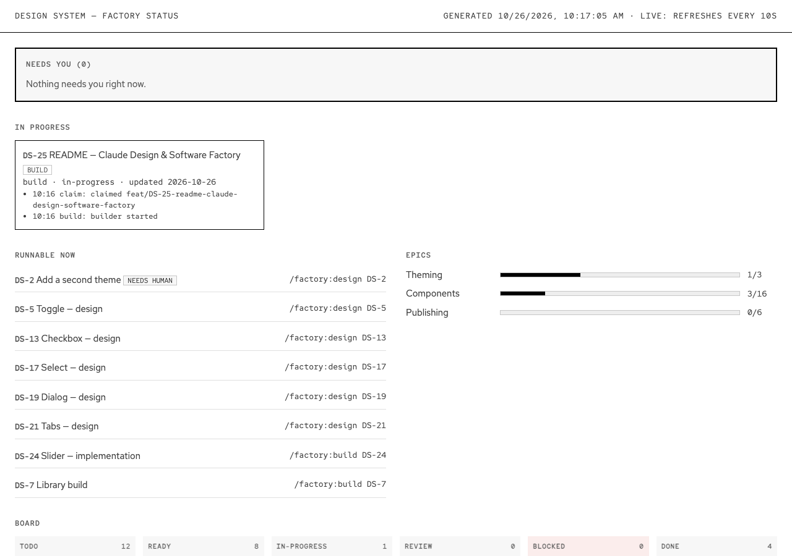

# Software factory

The factory takes tasks from [`roadmap.md`](../../roadmap.md), designs or builds each one in its own worktree with Claude subagents, checks the result with hard gates, opens a pull request, and merges it when checks pass and you've approved what needs approving. Everything is a Claude Code skill: you type `/factory:…`.



Design: [`design.md`](./design.md) · How designs are drawn and approved: [Claude Design](../claude-design.md) · Rules the skills follow: [`factory/plugin/RULES.md`](../../factory/plugin/RULES.md) · Reusable prompt for other projects: [`PROMPT.md`](./PROMPT.md)

## Setup (once)

1. Be logged in to Claude Code in the terminal (`claude`). No API key needed; your usage limit is the only budget.
2. Be logged in to GitHub CLI: `gh auth status`.
3. Open Claude Code in this repo and trust the folder. `.claude/settings.json` registers the repo-local plugin. Run `/plugin` and check that **factory@design-system-factory** is enabled; if it isn't, install it from the `design-system-factory` marketplace there (`/plugin marketplace add ./factory`). The root `.claude-plugin/marketplace.json` is the consumer marketplace `wireframe-ds`, not this one.

## Commands

| Command | What it does |
| --- | --- |
| `/factory:status [DS-n]` | Opens the status page (needs you, in progress, runnable, epics, board); with an ID, shows that task's job file. For a live page that refreshes every 10 s, run `npm run factory:status` in a terminal |
| `/factory:next [design\|build]` | Next runnable task and the command to start it |
| `/factory:plan [focus] [count]` | Researches the repo, backlog and job history, proposes the next features as tasks; you pick, it opens a roadmap PR |
| `/factory:add <feature>` | Turns a feature into roadmap tasks, previews them, opens a roadmap PR after your ok |
| `/factory:edit DS-n <change>` | Changes one todo/blocked task through a PR (incl. block/unblock, `needs_human`, deps) |
| `/factory:design DS-n` | Design line: canvas + spec → draft PR waiting for you |
| `/factory:design DS-n <feedback>` | Revises the design (same canvas link) |
| `/factory:build DS-n [opus]` | Build line: Builder → gates → QA → Reviewer → PR → merge on green checks |
| `/factory:approve DS-n` | Your approval: a design, or a PR that needs you; then it merges on green checks |
| `/factory:merge DS-n` | Re-checks a PR and merges it if the rules allow |
| `/factory:retry DS-n [opus] [--from stage] [--allow-ui]` | Resumes a blocked task, optionally with a stronger model |

Run one task per Claude Code session if you want several at once: each gets its own worktree and branch, and a task can't be taken twice.

## 1. Add a feature

```text
/factory:add Tooltip that shows on IconButton hover and keyboard focus
```

Claude asks up to 3 short questions, then shows the tasks exactly as they'll appear in `roadmap.md`, e.g. `DS-13 Tooltip — design` and `DS-14 Tooltip — implementation` (depends on DS-13). Say "ok" to apply. It opens a `roadmap: add …` PR that merges once checks are green.

| Feature | You get |
| --- | --- |
| Has UI | a design task, then a build task that depends on it |
| No UI (tooling, CI, docs) | one task: build, infra or docs |
| Needs new tokens, a release or secrets | the same, marked `needs_human` |
| More than 4 tasks | "split it into smaller features" |

## 1b. Plan the roadmap

```text
/factory:plan
/factory:plan components 3
/factory:plan publishing
```

The Planner (read-only) inventories `src/components`, specs, canvases, tokens, CI and the backlog, reads the factory's job history (blocked reasons, repeated failures), and looks for gaps (missing components, Radix primitives without a wrapper, missing infra). It may do a few web searches when the focus asks for an outside view. You get a summary, a recommended next task, and ranked features with the exact roadmap markdown. Answer `all`, `1,3` or a change; it lands only what you picked through a `roadmap: plan …` PR, like `/factory:add`.

## 2. Design a component

```text
/factory:design DS-3
```

The Designer draws `docs/design-system-wireframe/<Component>.dc.html` with every size and state, and writes `docs/specs/<Component>.md` (states, keyboard, Radix primitive, token mapping, a11y, token requests). The canvas is published to claude.ai, and a draft PR opens with the link. Then it's always your call:

```text
/factory:approve DS-3                       looks good → merges on green checks
/factory:design DS-3 make the counter right-aligned   → revision, same canvas link
```

The build task (DS-4) is ready once the approved spec is on `main`.

## 3. Build a task

```text
/factory:build DS-4
```

| Stage | What happens | If it fails |
| --- | --- | --- |
| Builder | TDD in `.worktrees/feat-DS-4-…`, from the approved spec if the task has UI | – |
| UI guard | `has_ui: no` tasks stop if they touch UI files (`docs` tasks may edit canvases in `docs/design-system-wireframe/`) | blocked; `/factory:retry DS-n --allow-ui` accepts it |
| Gates | lint, typecheck, test (coverage ≥ 80 %), build-storybook | back to Builder, max 2 loops |
| QA | Storybook vs spec and canvas, keyboard, axe; may add tests | back to Builder, max 2 loops |
| Reviewer | diff vs `done_when`, spec and `CLAUDE.md` | back to Builder, max 2 loops |
| PR | `DS-4: <title>`, each `done_when` with how it's met; task ticked in the roadmap | – |
| Merge | squash-merge when every check is green (and `factory:approved` if needed) | red check → back to Builder |

Your approval is needed before merge for design PRs, `needs_human` tasks, and UI changes you accepted with `--allow-ui`.

## 4. When something's blocked

The PR gets `factory:blocked` and a comment with the reason, the next step and the last output. The job file says the same.

```text
/factory:status DS-4          what happened (timeline + notes)
/factory:retry DS-4 opus      try again from the failed stage with a stronger model
```

To stop a run, press Esc in its session; then `/factory:retry` picks it up later.

## Job files

Each task has `factory/jobs/DS-<n>.md`: status, stage, links (branch, PR, canvas, Storybook), loop counts, model, a timeline of every step, gate results, and notes. It's written on the task branch while the task runs and lands in `factory/jobs/` when the PR merges, so the folder is the factory's history. Job files are created from [`TEMPLATE.md`](../../factory/jobs/TEMPLATE.md), and the status page reads [`factory/jobs/`](../../factory/jobs/). See the [jobs README](../../factory/jobs/README.md).

## Reference

### Roadmap task format

Tasks live in `roadmap.md`, each with a unique, never reused ID:

```md
- [ ] **DS-4 Textarea — implementation.** Description.
  - type: build · has_ui: yes · depends_on: DS-3 · needs_human: no · status: todo
  - done_when:
    - Criterion
```

- `type`: `design`, `build`, `infra` or `docs`.
- `has_ui`: whether it touches components, styles or stories. A UI build needs an approved spec from its design task.
- `depends_on`: task IDs that must be done first.
- `needs_human`: `yes` tasks are skipped by `/factory:next`, and their PR needs your approval.
- `status`: `todo`, `ready`, `in-progress`, `review`, `done` or `blocked`.
- `done_when`: the checklist the work is verified against.

### Skills

All skills live in [`factory/plugin/skills/`](../../factory/plugin/skills/), one folder each with a `SKILL.md`.

| Skill | What it does |
| --- | --- |
| [`/factory:status`](../../factory/plugin/skills/status/SKILL.md) | Opens the status page: needs you, in progress, runnable, epics, board. `npm run factory:status` keeps it live (refreshes every 10 s) |
| [`/factory:next`](../../factory/plugin/skills/next/SKILL.md) | Shows the next runnable task and the command to start it |
| [`/factory:plan`](../../factory/plugin/skills/plan/SKILL.md) | The Planner researches the repo, backlog and job history and proposes next features as tasks; you pick, a roadmap PR lands them |
| [`/factory:add`](../../factory/plugin/skills/add/SKILL.md) | Turns a feature into correctly shaped roadmap tasks, previews them, and opens a roadmap PR after your ok |
| [`/factory:edit`](../../factory/plugin/skills/edit/SKILL.md) | Changes a todo or blocked task (fields, `done_when`, block / unblock) through a PR |
| [`/factory:design`](../../factory/plugin/skills/design/SKILL.md) | Design line: canvas and spec, published to claude.ai, draft PR waiting for you; also revises with feedback |
| [`/factory:build`](../../factory/plugin/skills/build/SKILL.md) | Build line: Builder, gates, QA, Reviewer, PR, merge on green checks |
| [`/factory:approve`](../../factory/plugin/skills/approve/SKILL.md) | Your approval of a design or of a PR that needs a human |
| [`/factory:merge`](../../factory/plugin/skills/merge/SKILL.md) | Re-checks a PR and squash-merges it if the merge rules allow |
| [`/factory:retry`](../../factory/plugin/skills/retry/SKILL.md) | Resumes a blocked task, optionally with a stronger model or accepting a UI change |

### Agent pipeline

```text
planner -> designer -> builder -> QA -> reviewer
```

Definitions are in [`factory/plugin/agents/`](../../factory/plugin/agents/): [`planner`](../../factory/plugin/agents/planner.md) (read-only research that proposes tasks), [`designer`](../../factory/plugin/agents/designer.md) (canvas and spec), [`builder`](../../factory/plugin/agents/builder.md) (test-first implementation), [`qa`](../../factory/plugin/agents/qa.md) and [`reviewer`](../../factory/plugin/agents/reviewer.md) (independent checks). The orchestrating session runs every check as a real command; pass or fail is decided by exit codes and the rules, never by an agent's opinion, and no agent approves its own output.

### Hard gates

Before QA and review, the task's worktree must pass, in order:

1. `npm run lint`
2. `npm run typecheck`
3. `npm test` (coverage threshold 80 %)
4. `npm run build-storybook`

A `has_ui: no` task is also stopped if it touches UI files. A failure goes back to the Builder; after the loop limit the task is blocked with the reason posted on its PR.

### Human approval points

The factory never approves on your behalf. You are needed to:

- approve a design (`/factory:approve DS-n`) before its spec is merged and the build can start;
- approve a PR for a `needs_human` task, or one that accepts a UI change on a `has_ui: no` task (`/factory:approve DS-n`, `/factory:retry DS-n --allow-ui`);
- choose which proposed tasks land from `/factory:plan`, and confirm tasks previewed by `/factory:add` and `/factory:edit`;
- unblock tasks stopped at the loop limit (`/factory:retry DS-n`).

PRs merge only when all GitHub checks are green, the PR is mergeable, and the approval label is present where required.

## Where things live

| Path | What |
| --- | --- |
| `roadmap.md` | the backlog; changed only through PRs |
| `factory/jobs/DS-<n>.md` | per-task status and history |
| `docs/specs/<Component>.md` | design specs (approved = `approved: yes`) |
| `docs/design-system-wireframe/*.dc.html` | canvases |
| `factory/plugin/` | the plugin: `RULES.md`, `agents/`, `skills/` |
| `.factory/status.html` | the generated status page (gitignored) |
| `.worktrees/feat-DS-n-…` | each running task's worktree |

## Rules the factory never breaks

- Never pushes to `main` and never uses `--no-verify`.
- Never merges with a red or missing check, or without your approval where it's required.
- Never lets an agent approve its own work, and never approves on your behalf.
- Never writes secrets into job files, logs or PRs.
